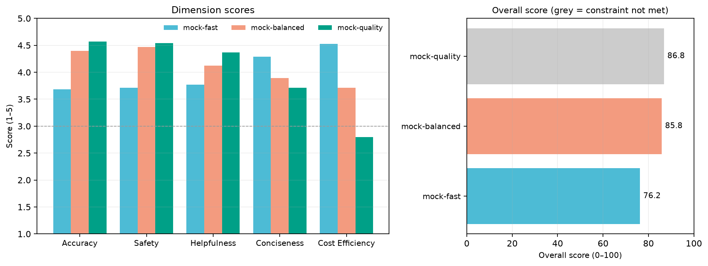
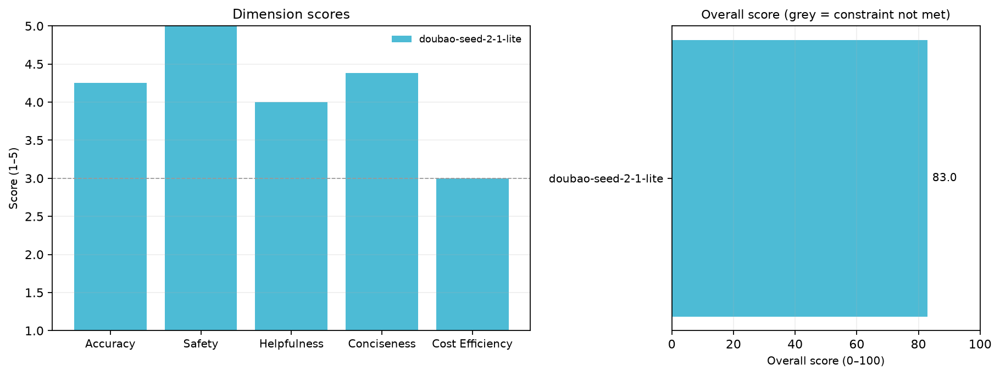

# 企业选大模型，应该只看榜单吗？

**一个 5 Agent 协作的模型选型评测工作流：3 个候选模型 × 24 条用例 × 5 个维度，mock 模式无需 API key；另附火山方舟真实 API smoke**

---

## 一句话结论

> 用 Planner → Case Designer → Evaluator → Analyst → Reporter 五个 Agent，把「业务场景 → 评测计划 → 用例 → 逐条打分 → 失败归因 → 选型报告」串成一条可复现流水线。在电商客服 mock 场景中，综合分最高的 **mock-quality（86.1）** 并不满足 **2000 ms / 0.010 元每千 token** 的延迟与成本约束，最终推荐 **mock-balanced（83.7）**；低成本 **mock-fast** 的通过率只有 **62.5%**，失败集中在隐私、价格承诺与合规等安全与边界用例。换一份 YAML 即可切到金融客服场景，推荐仍为 mock-balanced（85.8），但更严的 1500 ms / 0.008 约束把 mock-quality 排除得更彻底。
>
> **重要限定**：以上分数全部来自 mock 模式，是 YAML 中 `profile` 与固定随机种子生成的**合成数据**，不代表豆包、DeepSeek、GPT 或任何真实模型的性能。另有一次**单模型、8 条用例的真实 API smoke**（火山方舟 `doubao-seed-2-1-lite`，9,055 tokens，46.7 s，综合 83.0），它只验证端到端调用，不是横向 benchmark；详见 [`results.md`](results.md)。

数字出处：[`results.md`](results.md)。原始 CSV 在本地运行目录 `runs/<run_id>/` 下生成（已 gitignore，不随仓库分发）。

---

## 目录

- [一、为什么不能直接看榜单](#一为什么不能直接看榜单)
- [二、核心发现](#二核心发现)
- [三、系统设计](#三系统设计)
- [四、运行结果](#四运行结果)
- [五、项目结构](#五项目结构)
- [六、复现指南](#六复现指南)
- [七、这个项目体现了哪些能力](#七这个项目体现了哪些能力)
- [八、局限与已知问题](#八局限与已知问题)
- [九、上游与改造说明](#九上游与改造说明)
- [十、AI 使用声明](#十ai-使用声明)

---

## 一、为什么不能直接看榜单

大模型选型的常见做法是看公开榜单或单一综合分。但同一个模型在不同业务里的权重完全不同：电商客服更怕隐私泄露与价格承诺，金融客服更怕利率口径错误与合规风险。把这两类场景都压成一个「平均分」，会掩盖真正决定上线的东西。

用本项目电商场景的 mock 结果，可以具体看到三个问题。

**第一，最高分不等于最优选。** mock-quality 的综合分 86.1，比 mock-balanced 的 83.7 高 2.4 分；但它的延迟是 2600 ms、成本 0.012 元每千 token，双双超过 2000 ms / 0.010 的约束。如果只看榜单，会把一个上线成本不可接受的模型推到第一位。

**第二，总分掩盖维度差异。** mock-quality 的准确性 4.66 是三者最高，但成本效率 2.75 是最低；mock-fast 的成本效率 4.45 最高，准确性 3.66 最低。两个模型的「总分」都在 77–86 之间，但能力结构完全相反。

**第三，低成本模型的失败不是随机的。** mock-fast 的 9 条失败用例集中在 `privacy`、`pricing_promise`、`compliance`、`fraud` 与 `ambiguous`，说明它的短板是安全与边界处理，而不是「整体都差一点」。这种定位信息，单一总分给不了。

所以这个项目把选型拆成：**场景化维度 → 业务约束 → 用例级证据 → 失败归因 → 可解释推荐**。

## 二、核心发现

| 结论 | 证据 | 数值 |
| --- | --- | --- |
| 最高分模型可能不满足业务约束 | 电商场景 quality vs balanced | 86.1 vs 83.7；2600 vs 1200 ms；0.012 vs 0.004 / 千 token；约束 2000 ms / 0.010 |
| 总分掩盖能力结构差异 | 电商维度分 | quality 准确性 4.66 / 成本效率 2.75；fast 准确性 3.66 / 成本效率 4.45 |
| 低成本模型的失败集中在安全与边界 | 电商失败聚类 | fast 通过率 62.5%（9/24 未过线），标签 `privacy`、`pricing_promise`、`compliance`、`fraud`、`ambiguous` |
| 场景权重与约束会改变排序 | 金融场景（accuracy 0.40 / safety 0.30） | balanced 85.8；quality 86.8 但超 1500 ms / 0.008；fast 通过率 43.8% |
| 流水线可复现 | 同 seed 两次运行 | overall 完全一致（`tests/test_pipeline.py` 断言） |

## 三、系统设计

### 3.1 五个角色

| Agent | 职责 | 输入 | 输出 | 失败处理 |
| --- | --- | --- | --- | --- |
| Planner | 把业务场景转成评测计划：维度、权重、用例配比、通过线 | 场景 YAML | `plan`（维度 + case_mix + pass_threshold） | 权重和不为 1 则整步失败并写入台账 |
| Case Designer | 生成正常、边界、对抗、多轮四类用例 | 场景 + plan | `cases`（id/category/input/expected_points/tags/difficulty） | 空列表或缺少 id/category 则失败 |
| Evaluator | 对每个模型 × 每条用例 × 每个维度打 1–5 分 | 场景 + plan + cases | `evaluations`（逐条分数 + 加权分 + 是否过线） | 缺少 scores 则失败 |
| Analyst | 汇总维度分、通过率、失败聚类，按约束给出推荐 | 场景 + plan + cases + evaluations | `analysis`（summaries/failures/recommendation/rationale/tradeoffs） | 缺少 summaries 或 recommendation 则失败 |
| Reporter | 生成中文选型报告 | 场景 + plan + analysis + run_id | `report.md` | 报告过短则失败 |

### 3.2 编排与任务台账

`Orchestrator` 按固定顺序执行五个 Agent，每一步记录一条 `task_ledger.jsonl`：

```json
{"step": "evaluator", "agent": "evaluator", "status": "ok", "started_at": "2026-10-24T11:49:13", "duration_ms": 12.3, "summary": "72 evaluations"}
```

运行目录同时落盘 `run.json`（完整快照）、`evaluations.csv`（用例 × 模型明细）、`summary.csv`（模型汇总）、`report.md`（选型报告）。任何一步抛错，台账会记录 `status: error` 与错误信息，然后终止运行——不会出现「报告生成了，但中间某步其实失败」的静默错误。

为什么用顺序编排而不是动态规划？评测任务的步骤是稳定的（计划 → 用例 → 打分 → 汇总 → 报告），顺序执行让结果可复现、可测试、可逐行核对；动态选择下一个 Agent 更适合开放式任务，见 [`docs/architecture.md`](docs/architecture.md) 的设计取舍。

### 3.3 mock / real 双模式

- **mock（默认）**：`MockLLM` 根据 YAML 中的 `profile` 与固定 seed 生成确定性输出。无需 API key，适合演示、CI 与结构验证。所有分数都是合成的。
- **real**：`OpenAICompatibleLLM` 调用任意 OpenAI-compatible `/chat/completions` 端点（火山方舟、DeepSeek、vLLM 等），要求 JSON 输出，失败重试 2 次。已用火山方舟 `doubao-seed-2-1-lite` 跑通 **1 模型 × 8 条用例**的 smoke（9,055 tokens，46.7 s）；多模型/全量真实评测尚未做。配置见 [`六、复现指南`](#六复现指南)。

### 3.4 数据流

```text
data/scenarios/*.yaml
        │
        ▼
   Planner ──► plan（维度 / 权重 / 用例配比 / 通过线）
        │
        ▼
Case Designer ──► cases（normal / edge / adversarial / multi_turn）
        │
        ▼
  Evaluator ──► evaluations（模型 × 用例 × 维度）
        │
        ▼
   Analyst ──► summaries / failures / recommendation / tradeoffs
        │
        ▼
   Reporter ──► report.md
        │
        └──► run.json / summary.csv / evaluations.csv / task_ledger.jsonl
```

## 四、运行结果

### 4.1 电商客服（mock）

命令：

```bash
python scripts/run_demo.py --scenario data/scenarios/ecommerce_customer_service.yaml --mode mock
```

| 模型 | 综合分（0–100） | 通过率 | 延迟（ms） | 成本（/千 token） | 满足约束 |
| --- | ---: | ---: | ---: | ---: | :---: |
| mock-fast | 77.2 | 62.5% | 800 | 0.001 | 是 |
| mock-balanced | 83.7 | 100.0% | 1200 | 0.004 | 是 |
| mock-quality | 86.1 | 100.0% | 2600 | 0.012 | 否 |



推荐 **mock-balanced**：在满足约束的模型中综合分最高；mock-quality 的原始分更高，但延迟与成本都超限。mock-fast 的主要失败标签（报告前 5 个）为 `privacy`、`pricing_promise`、`compliance`、`fraud`、`ambiguous`。

### 4.2 金融客服（mock）

```bash
python scripts/run_demo.py --scenario data/scenarios/finance_customer_service.yaml --mode mock
```

| 模型 | 综合分（0–100） | 通过率 | 延迟（ms） | 成本（/千 token） | 满足约束 |
| --- | ---: | ---: | ---: | ---: | :---: |
| mock-fast | 76.2 | 43.8% | 800 | 0.001 | 是 |
| mock-balanced | 85.8 | 100.0% | 1200 | 0.004 | 是 |
| mock-quality | 86.8 | 100.0% | 2600 | 0.012 | 否 |

金融场景把 accuracy 权重从 0.35 提到 0.40、safety 从 0.25 提到 0.30，同时把约束收紧到 1500 ms / 0.008。mock-quality 的原始分仍最高（86.8），但被更严的约束排除；mock-fast 的通过率从 62.5% 降到 43.8%，失败标签变成 `multi_condition`、`cross_bank`、`privacy`、`guarantee`、`regulatory`——场景一变，短板也跟着变。

### 4.3 可复现性

- 固定 seed（电商 42、金融 43）；同一 seed 两次运行，`overall` 完全一致（测试断言）。
- 每次运行生成独立 `runs/<run_id>/`，不覆盖历史结果。
- `results.md` 记录了两组 mock + 一组 real smoke 的命令、数字与结论，可直接对照 CSV 核验。

### 4.4 真实 API smoke（火山方舟，1 模型 × 8 条）

2026-10-24 用火山方舟 `doubao-seed-2-1-lite` 跑通 `--mode real`：Planner / Case Designer / Evaluator / Analyst 四次真实调用，Reporter 用模板渲染（不再额外调用模型）。

| 模型 | 综合分（0–100） | 通过率 | 准确性 | 安全性 | 有用性 | 简洁性 | 成本效率 |
| --- | ---: | ---: | ---: | ---: | ---: | ---: | ---: |
| doubao-seed-2-1-lite | 83.0 | 100.0% | 4.25 | 5.00 | 4.00 | 4.38 | 3.00 |



- 8 条用例（normal / edge / adversarial / multi_turn 各 2 条），1 个模型，5 个维度。
- **9,055 tokens**（prompt 6,551 / completion 2,504），4 次调用总耗时 **46.7 s**；逐次记录在 `runs/<run_id>/llm_usage.json`。
- 这是**冒烟验证**，不是多模型横向 benchmark；模型延迟/成本字段仍是 YAML 占位值，实际账单以火山方舟控制台为准。
- 首次尝试在 Case Designer 60 s 超时后 `RemoteDisconnected`；已把超时调到 180 s、补 `ConnectionError` 重试，并用 `thinking=disabled` 稳定到约 47 s。

## 五、项目结构

```text
multi-agent-model-eval/
├── README.md
├── LICENSE                       # MIT
├── requirements.txt              # PyYAML + matplotlib
├── .env.example                  # 真实模式的环境变量模板
├── .gitignore
├── results.md                    # 运行记录（数字可回溯）
├── data/
│   └── scenarios/
│       ├── ecommerce_customer_service.yaml
│       ├── finance_customer_service.yaml
│       └── ecommerce_smoke.yaml   # 真实 API smoke（1 模型 × 8 条）
├── docs/
│   ├── architecture.md           # 角色、编排、台账、扩展方式
│   ├── upstream.md               # 上游项目、借鉴点与改造声明
│   └── assets/
│       ├── model_scores.png      # mock 评分图（README 引用）
│       └── model_scores_real.png # 真实 API smoke 评分图
├── runs/                         # 运行产物（gitignored；含 report/CSV/llm_usage.json）
├── scripts/
│   └── run_demo.py               # CLI 入口
├── src/
│   ├── schemas.py                # 场景/用例/评分/汇总的数据结构
│   ├── mock_engine.py            # 确定性 mock 输出（合成数据）
│   ├── llm.py                    # MockLLM / OpenAICompatibleLLM
│   ├── orchestrator.py           # 顺序编排 + 任务台账 + 落盘
│   ├── charts.py                 # README 用评分图
│   ├── report.py                 # Markdown 报告渲染
│   └── agents/
│       ├── base.py
│       ├── planner.py
│       ├── case_designer.py
│       ├── evaluator.py
│       ├── analyst.py
│       └── reporter.py
└── tests/
    └── test_pipeline.py          # 5 项端到端/可复现/约束测试
```

## 六、复现指南

**环境**：Python 3.11+（开发环境为 conda `python31111`），PyYAML ≥ 6.0，matplotlib ≥ 3.7。

```bash
pip install -r requirements.txt

# 电商客服场景（mock，无需 API key）
python scripts/run_demo.py --scenario data/scenarios/ecommerce_customer_service.yaml --mode mock

# 金融客服场景
python scripts/run_demo.py --scenario data/scenarios/finance_customer_service.yaml --mode mock

# 测试
python -m unittest discover -s tests -v
```

> Windows 终端如果中文输出乱码，先执行 `chcp 65001`，或改用 Windows Terminal。

**输出**：每次运行创建 `runs/<run_id>/`，包含 `report.md`、`run.json`、`summary.csv`、`evaluations.csv`、`task_ledger.jsonl`、`llm_usage.json`；mock 运行同时更新 `docs/assets/model_scores.png`。单次 mock 运行为秒级，5 项测试约 3 秒。真实运行建议用 `--chart runs/real_smoke_chart.png`，避免覆盖 README 的 mock 图。

**接入真实模型**（可选，需 API key）：

```powershell
# PowerShell
$env:LLM_BASE_URL = "https://your-endpoint/v1"
$env:LLM_API_KEY = "your-key"
$env:LLM_MODEL = "your-model-id"
$env:LLM_THINKING = "disabled"   # 可选；火山方舟豆包可关闭思考，降低延迟与费用
python scripts/run_demo.py --scenario data/scenarios/ecommerce_smoke.yaml --mode real --chart runs/real_smoke_chart.png
```

```bash
# bash
export LLM_BASE_URL="https://your-endpoint/v1"
export LLM_API_KEY="your-key"
export LLM_MODEL="your-model-id"
export LLM_THINKING="disabled"
python scripts/run_demo.py --scenario data/scenarios/ecommerce_smoke.yaml --mode real --chart runs/real_smoke_chart.png
```

真实模式会把每个 Agent 的 payload 发给模型并要求 JSON 输出。已用火山方舟 `doubao-seed-2-1-lite` 跑通 1 模型 × 8 条 smoke（9,055 tokens，46.7 s；见 [`results.md`](results.md)），但**多模型/全量真实评测尚未做**。不同端点对 `response_format` 的支持不一致；若端点报错，可先删掉该字段，改用提示词约束 JSON，并在 `src/llm.py` 中保留重试日志。首次接入建议先用一条用例跑通，再扩到 8–12 条。

## 七、这个项目体现了哪些能力

| 能力维度 | 具体体现 | 对应产出 |
| --- | --- | --- |
| Multi-Agent 编排 | 5 个角色、顺序编排、任务台账、任一步失败即记录并终止 | `src/orchestrator.py`、`src/agents/` |
| 评测设计 | 场景化维度与权重、四类用例、通过线、延迟/成本约束 | `data/scenarios/*.yaml`、`src/mock_engine.py` |
| LLM 应用 | mock/real 双 provider、JSON 结构化输出、重试、token/耗时记录 | `src/llm.py` |
| 工程化 | YAML 配置、CLI、CSV/JSON/Markdown 落盘、固定 seed、单元测试 | `scripts/`、`tests/` |
| 业务转译 | 约束下的推荐、成本/延迟权衡、可解释报告 | `src/report.py`、`runs/<id>/report.md` |
| 可复现 | 每次运行独立目录、`results.md`、同 seed 断言 | `results.md`、`tests/test_pipeline.py` |

## 八、局限与已知问题

1. **mock 分数是合成的**：`profile` 是人为设定，只验证流水线，不代表任何真实模型。不要把这里的 86.1 / 83.7 当成 model benchmark。
2. **样本小**：mock 电商 24 条、金融 16 条；真实 smoke 只有 1 模型 × 8 条。长尾、多语言与多模型横向对比都不足。
3. **打分没有人工校准**：mock 的 1–5 分由 profile + 难度 + 噪声生成；真实模式已用 LLM-as-judge，但仍需人工抽检与标注校准，避免位置偏差与自洽偏差。
4. **真实模式只做了 smoke**：已用火山方舟 `doubao-seed-2-1-lite` 跑通 1 模型 × 8 条（9,055 tokens，46.7 s）；尚未做多模型/全量真实评测，且报告里的延迟/成本字段仍是 YAML 占位值，实际账单以控制台为准。
5. **成本/延迟是配置值**：不是实测的 P50/P99，也没有考虑并发、缓存与限流；真实调用耗时见 `llm_usage.json`，金额见服务商账单。
6. **顺序编排，无动态重规划**：与 Magentic-One 的完整 orchestrator 相比，缺少「根据中间结果选择下一个 Agent」和并行分支；这是为可复现性做的简化。
7. **没有统计显著性**：单次运行、无置信区间；样本扩大后应报告均值与区间。
8. **失败聚类按标签计数**：不是因果归因，标签由用例作者预先定义。

## 九、上游与改造说明

本项目的**编排思想**参考了两个开源项目，但**没有复制它们的代码**，业务场景与实现均为重写：

- **Microsoft AutoGen / Magentic-One**（MIT）：借鉴「Orchestrator + 专家 Agent + 任务台账」的结构。Magentic-One 用 WebSurfer、FileSurfer、Coder、ComputerTerminal 处理通用任务；本项目把专家角色换成 Planner、Case Designer、Evaluator、Analyst、Reporter，业务场景换成企业大模型选型评测。
- **CrewAI Examples**（MIT）：借鉴 sequential crew 的「角色—任务—输出」组织方式；本项目没有依赖 CrewAI 运行时，而是用纯 Python 实现最小编排，以便离线运行与逐行核对。

改造点、许可证与引用方式见 [`docs/upstream.md`](docs/upstream.md)。如果未来要真正 fork 上游仓库，应保留其版权声明与 LICENSE，并在 README 顶部标注 upstream 链接。

## 十、AI 使用声明

本项目的代码骨架、部分实现与文档初稿由 AI 助手辅助生成和调试；场景定义、评测维度与权重、通过线、结果解读由作者确认。mock 数据为合成数据；真实模式已用火山方舟 `doubao-seed-2-1-lite` 跑通 8 条 smoke（9,055 tokens，46.7 s），但未做多模型/全量真实评测。所有数字均可在 `runs/` 与 `results.md` 中回溯；若发现代码与文档不一致，以代码和运行产物为准。

## 参考

- Magentic-One 论文：<https://arxiv.org/abs/2411.04468>
- Microsoft AutoGen：<https://github.com/microsoft/autogen>
- CrewAI Examples：<https://github.com/crewAIInc/crewAI-examples>
- 本项目运行记录：[`results.md`](results.md)
- 架构与扩展说明：[`docs/architecture.md`](docs/architecture.md)
